<!-- komarev hard-codes the grey on its label half, so it could not be drawn to
     match. This one takes both colours: the chip surface on the left, the accent
     on the count. It is a different service, so the count restarts; komarev keeps
     the old total under the username if this is ever switched back. -->

 

Two years at **Vocsy Infotech**, promoted from intern to developer in six months. Most profiles stop at the code. I get handed a domain and give back a site that is live, which means the DNS, the SSL, the server, the store and the theme are all mine to get right.

 

| Project | Stack | What it is |
|---------|-------|------------|
| **[heliosexport.com](https://heliosexport.com)** | WooCommerce | Jewellery export storefront. Full build: product catalogue, categories, checkout. |
| **[shop.sanmarfoods.com](https://shop.sanmarfoods.com)** | Shopify · Liquid | Food and snacks retailer in Singapore. Theme sections and product pages customized in Liquid. |
| **Blog network, 50+ sites** | WordPress · Claude Code | Designed, built and launched end to end. Standardized theme and plugin stack, every generated change reviewed per site, about a day per site. |

 

### ⚙️ How 50+ sites actually happen

The number is not a flex, it is the proof that the workflow holds up. What it is made of:

* **Agents that run multi-step jobs** — plan, call tools, carry a task through, instead of one-off prompts.
* **A standardized base** so every site starts from the same reviewed theme and plugin stack, and only the real differences get built.
* **Every generated change reviewed before it ships.** The speed comes from the workflow, not from trusting the output.
* **Internal AI dashboards and tooling** so the people who are not developers can still run the thing.

 

### 📦 Open source

| Repo | What is in it |
|------|---------------|
| **[ai-engineer-roadmap](https://github.com/rudrakshgoswami/ai-engineer-roadmap)** | A 24-week AI engineering plan, rebuilt as a site you can actually work through: [ai-engineer-roadmap-drab.vercel.app](https://ai-engineer-roadmap-drab.vercel.app). The roadmap is Aditya Dewaskar’s, the build is mine. 314 free resources lifted out of an 18-page PDF and counted against the arrow glyphs printed beside them so the number is proved rather than claimed, then search, filters, progress tracking and two themes on top. |
| **[vincent-app](https://github.com/rudrakshgoswami/vincent-app)** | MERN restaurant, venue and catering booking platform. Venue slots lock in real time over Socket.io with a cleanup sweeper, so two people cannot book the same evening. Ships with a demo payment gateway and 110 seeded menu items, so it runs with no API keys at all. |
| **[ipl-data-analysis](https://github.com/rudrakshgoswami/ipl-data-analysis)** | Nine IPL seasons in pandas. The interesting part is the negative result: the toss is a 50.7% coin flip, and the match-winner model loses to a trivial baseline. Published as a finding rather than hidden behind an accuracy score. |

 

### 🚀 Right now

* 🔭 Building AI agents, automation and internal AI dashboards at **Vocsy Infotech**
* 🌱 Going deeper on **LLM evaluation, agent orchestration and Python for production ML**
* 🤝 Open to **freelance website, e-commerce and automation work** — hire me on [Fiverr](https://www.fiverr.com/rudraksh_2005) or [Freelancer](https://www.freelancer.in/u/rudrakshgoswami7)
* 💬 Ask me about shipping e-commerce stores, AI-assisted development, hosting, DNS and migrations

 

 

**Let's build something that ships.**

<!-- Upwork is deliberately not shown yet: profile visibility is locked to Private until
     Connects and identity verification are done, so the link is dead for everyone.
     The chip is built and committed. Delete the two comment markers once it is public.

-->

